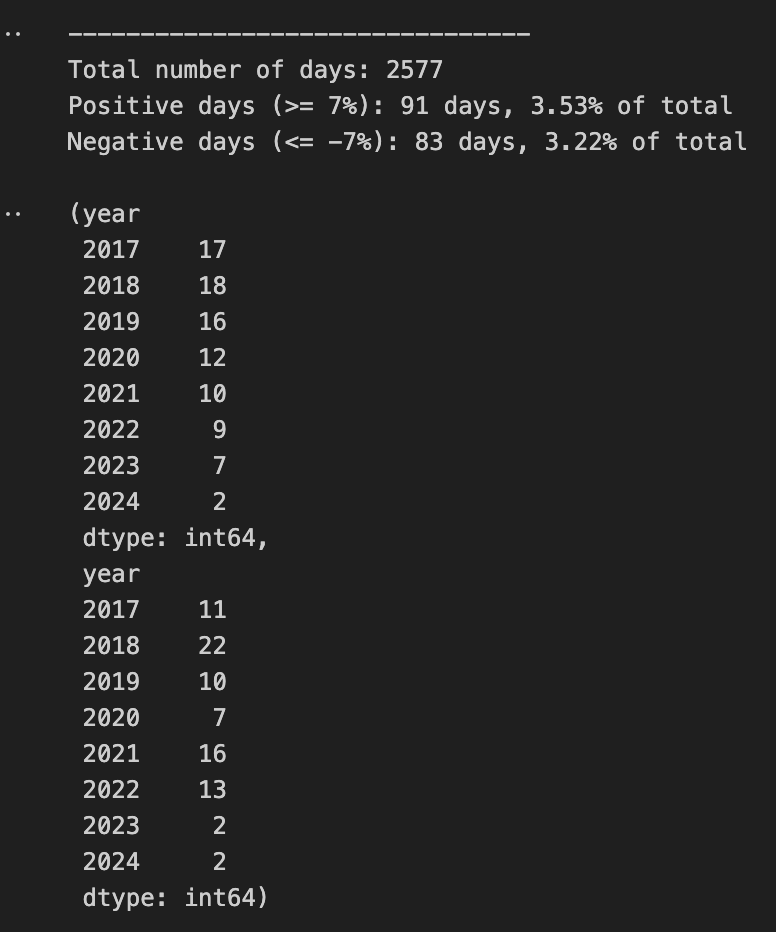
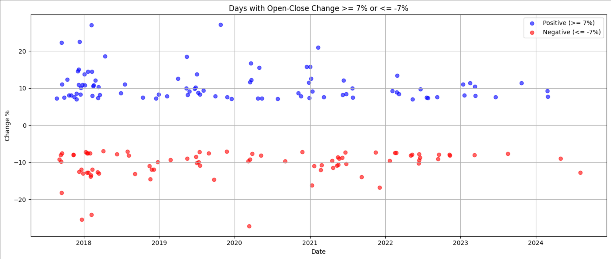

# BTC_OPTIONS: 비트코인 옵션 양매도 리스크 분석

> 7년치 비트코인 가격 데이터로, 매도하려는 옵션의 행사가격이 과거에 얼마나 자주 뚫렸는지 미리 확인하는 분석

| 항목 | 내용 |
|---|---|
| 유형 | 개인 프로젝트 |
| 데이터 | Binance API 1시간봉 (2017 – 2024) |
| 기술 | Python, pandas, matplotlib, python-binance |

<br>

## 문제
옵션 양매도는 이익이 제한적인 반면 손실은 이론적으로 무한할 수 있는 전략입니다. 만기가 하루인 옵션을 매도할 때, 고른 행사가격이 얼마나 위험한지 과거 데이터로 먼저 확인하고 싶었습니다.

## 접근
1. **데이터 수집**: Binance API로 2017년부터 1시간봉 데이터 수집
2. **일봉 재구성**: 옵션 만기 시각에 맞춰 오후 5시부터 다음 날 오후 5시까지를 하루로 묶어 일봉 생성
3. **변화율 계산**: 하루 시가 대비 종가 변화율 계산
4. **리스크 평가**: 사용자가 입력한 변화율 k를 넘은 날짜와 횟수를 집계·시각화

예를 들어 현재 가격보다 7% 아래에서 풋옵션을 매도한다면, 과거 7년 동안 하루 만에 7% 넘게 떨어진 날이 몇 번이었는지 바로 확인할 수 있습니다.




## 결과·활용
과거 데이터를 근거로 행사가격별 위험을 숫자로 비교할 수 있어, 옵션 매도 전 행사가격을 더 신중하게 고르는 데 쓸 수 있습니다.

## 파일 구성
```text
BTC_OPTIONS
├── BTC_OPTIONS/
│   ├── main.py                        # Binance API 데이터 수집
│   ├── data.ipynb                     # 일봉 재구성, 변화율 계산, 시각화
│   ├── btc_1h_data_2017_to_2024.csv   # 1시간봉 원자료
│   ├── btc_daily_change_rates.csv     # 일별 변화율
│   └── btc_deribit_daily_cleaned.csv  # 정리한 일별 데이터
└── doc/                               # 결과 이미지
```
